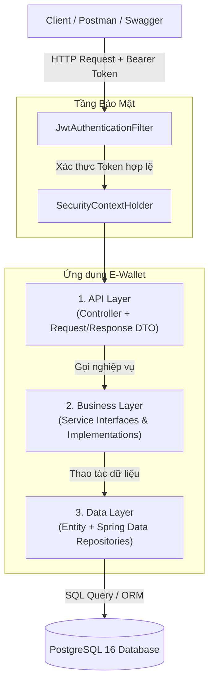
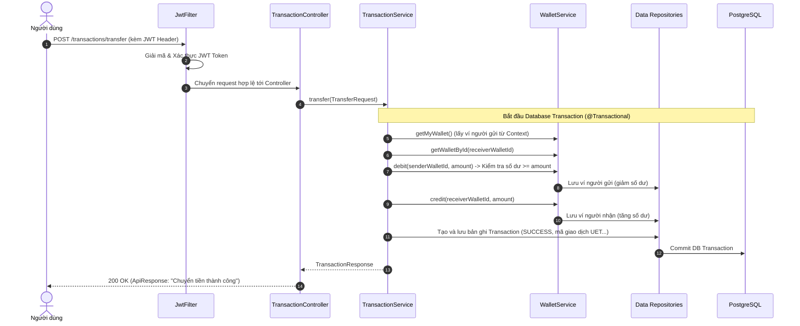
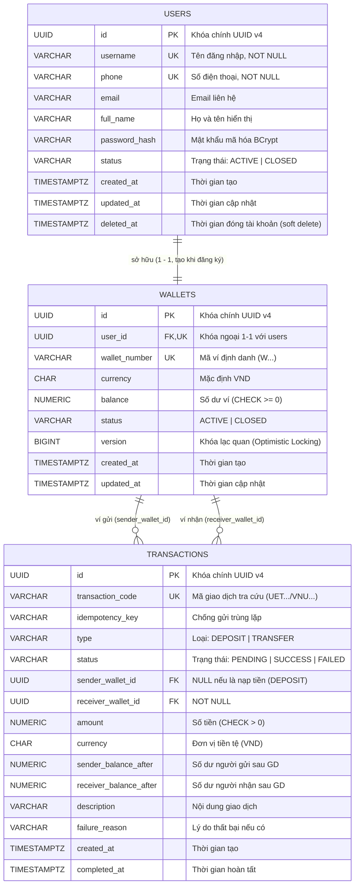
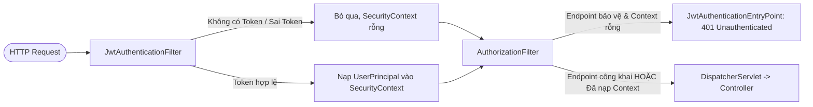

# E-Wallet Backend (Pha 1)

> **Bài tập lớn** - Xây dựng dịch vụ backend Ví điện tử (E-Wallet) chuẩn RESTful với kiến trúc phân tầng 3 lớp, bảo mật JWT tập trung, đóng gói Docker 

---

##  Mục lục

1. [Giới thiệu & Nghiệp vụ cốt lõi](#1-giới-thiệu--nghiệp-vụ-cốt-lõi)
2. [Thành viên nhóm & Phân công đóng góp](#2-thành-viên-nhóm--phân-công-đóng-góp)
3. [Công nghệ & Framework](#3-công-nghệ--framework)
4. [Kiến trúc hệ thống & Luồng xử lý](#4-kiến-trúc-hệ-thống--luồng-xử-lý)
5. [Cấu trúc thư mục mã nguồn](#5-cấu-trúc-thư-mục-mã-nguồn)
6. [Mô hình dữ liệu (ERD)](#6-mô-hình-dữ-liệu-erd)
7. [Đặc tả API](#7-đặc-tả-api)
8. [Bảo mật & Cơ chế xác thực](#8-bảo-mật--cơ-chế-xác-thực)
9. [Hướng dẫn Triển khai & Chạy ứng dụng (Deploy & Run)](#9-hướng-dẫn-triển-khai--chạy-ứng-dụng-deploy--run)
10. [Kiểm thử & Đảm bảo chất lượng](#10-kiểm-thử--đảm-bảo-chất-lượng-qa)


---

## 1. Giới thiệu & Nghiệp vụ cốt lõi

**E-Wallet** là hệ thống backend cung cấp RESTful API mô phỏng toàn bộ luồng nghiệp vụ cơ bản của một ví điện tử cá nhân:

| Nghiệp vụ | Mô tả chi tiết |
|---|---|
|  **Xác thực (Auth)** | Đăng ký tài khoản (tự động khởi tạo ví với số dư 0 VND), Đăng nhập nhận JWT token (hạn 24h), Đóng tài khoản (Soft delete, yêu cầu số dư = 0) |
|  **Nạp tiền (Deposit)** | Nạp tiền vào ví của người dùng đang đăng nhập; cập nhật số dư tức thì và ghi vết giao dịch |
|  **Chuyển tiền (Transfer)** | Chuyển tiền từ ví người gửi tới ví người nhận bằng `receiverWalletId`; kiểm tra số dư, cập nhật số dư cả 2 ví và lưu giao dịch trong cùng 1 Transaction DB |
|  **Lịch sử giao dịch** | Xem danh sách giao dịch phân trang (gồm cả nạp, gửi, nhận) và xem chi tiết từng giao dịch theo mã UUID |

### Phạm vi hoàn thành trong Pha 1
- Chuẩn RESTful giao tiếp JSON với các HTTP method: `GET`, `POST`, `DELETE`
- Áp dụng kiến trúc 3 lớp: `API (Controller + DTO)` → `Business (Service)` → `Data (Repository + Entity)`
- Xác thực tập trung bằng **Spring Security Filter Chain** + **JWT (Stateless)**
- Xử lý ngoại lệ và phản hồi đồng nhất qua `ApiResponse<T>` và `GlobalExceptionHandler`
- Đóng gói triển khai chuẩn hóa qua **Docker** và **Docker Compose**.
- Kiểm thử tích hợp tự động qua **GitHub Actions CI** và kiểm thử tải với **Locust**

---

## 2. Thành viên nhóm & Phân công đóng góp


| STT | Họ và tên | MSSV | Vai trò chính |  Nhiệm vụ phụ trách chính |
|:---:|---|:---:|---|---|
| 1 | **Đinh Quang Tuân** | 24021654 | Backend / Security  | User module, Đăng ký/Đăng nhập, JWT Filter, Spring Security, Đóng tài khoản (soft delete), Setup GitHub Actions CI pipeline |
| 2 | **Đặng Duy Anh** | 24021358 | Backend / Wallet  | Wallet module, logic kiểm tra và cập nhật số dư (credit/debit), Wallet Service, Wallet Repository, Unit test Wallet |
| 3 | **Lê Tùng Dương** | 24021438 | Backend / Transaction  | Transaction module, logic chuyển tiền & nạp tiền, Transaction Repository, Transaction History paging |
| 4 | **Hoàng Đức Nhuận** | 24021590 | DevOps / QA  | DTO, Mapper (MapStruct), Swagger/OpenAPI config, Dockerfile & Docker Compose, kịch bản kiểm thử tải Locust , PR review & merge |

---

## 3. Công nghệ & Framework

| Thành phần | Công nghệ / Thư viện | Phiên bản | Mục đích sử dụng |
|---|---|:---:|---|
| **Ngôn ngữ** | Java | 21 (LTS) | Tận dụng Virtual Threads, Record, Pattern Matching |
| **Framework chính** | Spring Boot | 4.1.1 / 3.x | Framework xây dựng dịch vụ RESTful Backend |
| **Bảo mật** | Spring Security + JJWT | 0.12.6 | Xác thực Stateless qua JWT token (thuật toán HS256) |
| **ORM / Data** | Spring Data JPA / Hibernate | Tích hợp | Quản trị kết nối cơ sở dữ liệu, Repository Pattern |
| **Cơ sở dữ liệu** | PostgreSQL | 16-alpine | RDBMS lưu trữ dữ liệu chính |
| **Object Mapping** | MapStruct + Lombok | 1.6.3 | Ánh xạ tự động DTO ↔ Entity, giảm boilerplate code |
| **Validation** | Jakarta Bean Validation | Tích hợp | Kiểm tra tính hợp lệ của request payload đầu vào |
| **Đặc tả API** | SpringDoc OpenAPI (Swagger UI) | 3.1.1 | Sinh tài liệu OpenAPI 3.0 tự động (`/swagger-ui/index.html`) |
| **Đóng gói** | Docker & Docker Compose | Multi-stage | Đóng gói ứng dụng chạy độc lập cùng database |
| **Load Testing** | Locust (Python) | 2.x | Kiểm thử tải đồng thời các kịch bản nạp tiền/xem lịch sử |
| **CI Pipeline** | GitHub Actions | v4 | Tự động build, kiểm tra phụ thuộc và chạy Unit/Mock Tests |

---

## 4. Kiến trúc hệ thống & Luồng xử lý

### 4.1. Tổng quan kiến trúc 3 lớp (3-Layer Architecture)

Mã nguồn tuân thủ nghiêm ngặt **Nguyên tắc một chiều (Dependency Rule)**: Tầng trên phụ thuộc vào tầng dưới, tầng dưới không biết tầng trên.



### 4.2. Luồng xử lý một Request nghiệp vụ: Chuyển tiền (`POST /transactions/transfer`)



---

## 5. Cấu trúc thư mục mã nguồn

```
eWallet/
├── .github/workflows/
│   └── build.yml               
├── loadtest/
│   └── locustfile.py           
├── docker-compose.yml         
├── openapi.yaml               
├── README.md                  
└── eWallet/                    
    ├── Dockerfile              
    ├── pom.xml                 
    └── src/
        ├── main/
        │   ├── java/uet/com/eWallet/
        │   │   ├── EWalletApplication.java      
        │   │   ├── api/                          
        │   │   │   ├── controller/               
        │   │   │   └── dto/                      
        │   │   ├── business/                   
        │   │   │   └── service/                 
        │   │   ├── data/                        
        │   │   │   ├── entity/                   
        │   │   │   └── repository/             
        │   │   ├── security/                    
        │   │   ├── mapper/                    
        │   │   ├── exception/                    
        │   │   └── config/                       
        │   └── resources/
        │       └── application.yaml            
        └── test/                                 
```

---

## 6. Mô hình dữ liệu (ERD)

Cơ sở dữ liệu gồm **3 thực thể cốt lõi** với quan hệ chặt chẽ:
- **`users` ↔ `wallets`**: Quan hệ `1 — 1`. Mỗi tài khoản sở hữu duy nhất 1 ví (tự động tạo ngay khi đăng ký).
- **`wallets` ↔ `transactions`**: Quan hệ `1 — N`. Một ví có thể là bên gửi (`sender_wallet_id`) hoặc bên nhận (`receiver_wallet_id`).



---

## 7. Đặc tả API

### 7.1. File đặc tả API tĩnh (`openapi.yaml`)
Toàn bộ đặc tả API được lưu trữ độc lập tại file [`openapi.yaml`](./openapi.yaml) ở thư mục gốc.

> **Cách Preview nhanh file `.yaml`:**
> 1. **Preview Online**: Truy cập [Swagger Editor Online](https://editor.swagger.io/) và chọn `File` ➔ `Import File` ➔ chọn file [`openapi.yaml`](./openapi.yaml).
> 2. **Preview trên VS Code**: Cài extension *Swagger Viewer*  hoặc *OpenAPI Editor*.
> 3. **Preview trực tiếp từ server đang chạy**: Truy cập `http://localhost:8081/swagger-ui/index.html`.

### 7.2. Danh sách 8 Endpoint chuẩn RESTful

| # | Phương thức | Endpoint | Chức năng nghiệp vụ | Xác thực | Mã thành công |
|:---:|:---:|---|---|:---:|:---:|
| 1 | `POST` | `/auth/register` | Đăng ký tài khoản (tự động tạo ví với số dư 0 VND) | Public | `201 Created` |
| 2 | `POST` | `/auth/login` | Đăng nhập hệ thống, nhận JWT access token | Public | `200 OK` |
| 3 | `GET` | `/users/me` | Lấy thông tin tài khoản và số dư ví của user hiện tại | JWT | `200 OK` |
| 4 | `DELETE`| `/users/me` | Đóng tài khoản (Soft delete, yêu cầu số dư ví = 0) | JWT | `200 OK` |
| 5 | `POST` | `/transactions/deposit` | Nạp tiền vào ví của user hiện tại | JWT | `200 OK` |
| 6 | `POST` | `/transactions/transfer`| Chuyển tiền từ ví hiện tại sang ví khác | JWT | `200 OK` |
| 7 | `GET` | `/transactions` | Xem lịch sử giao dịch phân trang (`page`, `size`) | JWT | `200 OK` |
| 8 | `GET` | `/transactions/{id}` | Xem chi tiết 1 giao dịch theo mã UUID | JWT | `200 OK` |

### 7.3. Định dạng phản hồi chuẩn (`ApiResponse<T>`)

Mọi phản hồi từ hệ thống (kể cả thành công hay thất bại) đều tuân theo cấu trúc JSON chuẩn hóa:

**1. Định dạng khi thành công:**
```json
{
  "code": 200,
  "message": "Thành công",
  "result": {}
}
```

**2. Định dạng khi có lỗi:**
```json
{
  "code": 1012,
  "message": "Số dư không đủ",
  "result": null
}
```

**Bảng mã lỗi và trạng thái HTTP chuẩn hóa (`ErrorCode`):**

| HTTP Status | `code` | Tên mã lỗi | Ý nghĩa thực tế |
|:---:|:---:|---|---|
| 200 / 201 | `200` / `201` | `SUCCESS` | Yêu cầu xử lý thành công / Tạo mới thành công |
| 400 | `1001` | `USER_EXISTED` | Tên đăng nhập đã tồn tại trong hệ thống |
| 400 | `1002` | `PHONE_EXISTED` | Số điện thoại đã được đăng ký |
| 400 | `1003` | `EMAIL_EXISTED` | Địa chỉ email đã tồn tại |
| 404 | `1004` | `USER_NOT_FOUND` | Không tìm thấy tài khoản người dùng |
| 401 | `1005` | `INVALID_CREDENTIALS` | Tên đăng nhập hoặc mật khẩu không chính xác |
| 403 | `1006` | `ACCOUNT_CLOSED` | Tài khoản đã bị đóng, không thể thao tác |
| 401 | `1007` | `UNAUTHENTICATED` | Chưa xác thực hoặc Token JWT hết hạn / không hợp lệ |
| 400 | `1008` | `INVALID_INPUT` | Tham số payload không đúng định dạng / validation |
| 404 | `1009` | `WALLET_NOT_FOUND` | Không tìm thấy ví tương ứng |
| 403 | `1010` | `WALLET_NOT_ACTIVE` | Ví đang trong trạng thái bị khóa / đóng |
| 400 | `1011` | `INVALID_AMOUNT` | Số tiền giao dịch phải lớn hơn 0 |
| 422 | `1012` | `INSUFFICIENT_BALANCE` | Số dư trong ví không đủ để thực hiện chuyển tiền |
| 409 | `1013` | `WALLET_ALREADY_EXISTS` | Người dùng đã có ví, không thể tạo thêm |
| 409 | `1014` | `WALLET_NOT_EMPTY` | Không thể đóng tài khoản khi ví vẫn còn số dư |
| 404 | `1015` | `TRANSACTION_NOT_FOUND` | Không tìm thấy giao dịch theo UUID cung cấp |
| 401 | `1016` | `UNAUTHORIZED` | Bạn không có quyền truy cập chức năng này |
| 500 | `9999` | `UNCATEGORIZED_EXCEPTION` | Lỗi ngoại lệ hệ thống chưa định danh |

---

## 8. Bảo mật & Cơ chế xác thực

Hệ thống áp dụng kiến trúc xác thực **Stateless** hoàn toàn:
1. **Mật khẩu người dùng**: Được băm an toàn bằng thuật toán **BCrypt** trước khi lưu vào database.
2. **JWT Token**: Ký bằng thuật toán **HMAC-SHA256 (HS256)** với secret key độ dài 256-bit, thời hạn sống mặc định là **24 giờ**.
3. **Filter Chain tập trung**: Mọi request đi qua `JwtAuthenticationFilter`. Nếu token hợp lệ, thông tin `UserPrincipal` (chứa `userId`, `username`) được nạp vào `SecurityContextHolder`.



---

## 9. Hướng dẫn Triển khai & Chạy ứng dụng (Deploy & Run)

Phần này hướng dẫn các nhóm nhận bàn giao **Pha 2** có thể clone mã nguồn về và khởi chạy ngay lập tức.

### Yêu cầu môi trường cài đặt sẵn:
- **Git**
- **Docker & Docker Compose** HOẶC **JDK 21** + **Maven 3.9+** + **PostgreSQL 16**

---

### Cách 1: Khởi chạy trọn gói bằng Docker Compose 
Chỉ cần 1 câu lệnh duy nhất để build ứng dụng và khởi tạo cơ sở dữ liệu:

```bash
# 1. Clone repository về máy
git clone <repository_url>
cd eWallet

# 2. Khởi chạy toàn bộ hệ thống 
docker compose up -d --build
```

- **Backend API**: `http://localhost:8081`
- **Swagger UI**: `http://localhost:8081/swagger-ui/index.html`
- **PostgreSQL Database**: `localhost:5433` (User: `postgres`, Pass: `password123`, DB: `ewallet_db`)

Dừng hệ thống:
```bash
docker compose down
```

---

### Cách 2: Khởi chạy trong môi trường phát triển (Local Development)

#### Bước 1: Khởi động database PostgreSQL
Dùng Docker để bật riêng database:
```bash
docker compose up -d postgres
```

#### Bước 2: Build và chạy ứng dụng Spring Boot
```bash
cd eWallet

# Cấp quyền chạy cho Maven Wrapper (nếu dùng Linux/macOS)
chmod +x mvnw

# Chạy ứng dụng
./mvnw spring-boot:run
# Đối với Windows Command Prompt / PowerShell:
.\mvnw.cmd spring-boot:run
```

---

## 10. Kiểm thử & Đảm bảo chất lượng (QA)

### 10.1. Kiểm thử tự động (Unit & Mock Tests)
Dự án tích hợp bộ kiểm thử đơn vị sử dụng `JUnit 5` và `Mockito` để kiểm tra các luồng Auth, User và Wallet Service:
```bash
cd eWallet
./mvnw clean test
```

### 10.2. CI Pipeline (GitHub Actions)
File cấu hình [`.github/workflows/build.yml`](./.github/workflows/build.yml) tự động kích hoạt mỗi khi có `push` hoặc tạo `Pull Request` vào nhánh `main`:
1. Thiết lập môi trường **JDK 21 Temurin**.
2. Khởi chạy container **PostgreSQL 16** và chờ trạng thái `pg_isready`.
3. Chạy toàn bộ bộ test tự động (`./mvnw clean test`).
4. Đóng gói file JAR (`./mvnw package -DskipTests`).

### 10.3. Kiểm thử tải (Load Testing với Locust)
Kịch bản tải [`loadtest/locustfile.py`](./loadtest/locustfile.py) mô phỏng hành vi người dùng thật với các trọng số:
- Xem hồ sơ `GET /users/me` (Weight: 5)
- Xem lịch sử giao dịch `GET /transactions` (Weight: 3)
- Xem chi tiết giao dịch `GET /transactions/{id}` (Weight: 2)
- Nạp tiền `POST /transactions/deposit` (Weight: 1)

**Cách chạy Locust:**
```bash
# Cài đặt locust
pip install locust

# Chạy test hướng vào server local
locust -f loadtest/locustfile.py --host=http://localhost:8081
```
Mở trình duyệt truy cập `http://localhost:8089` để cấu hình số lượng User đồng thời và xem biểu đồ throughput (RPS) / latency.

#### Kết quả kiểm thử tải thực tế (Stress Test Report)

**Kịch bản kiểm nghiệm:**
* **Quy mô tải (Concurrency):** `100 users` đồng thời gửi request liên tục.
* **Thời gian chạy kiểm thử:** `1 phút` (60 giây).
* **Thời gian giãn cách (Think time):** Ngẫu nhiên từ `0.1s – 0.5s` giữa các request (`between(0.1, 0.5)`).
* **Mục tiêu:** Kiểm tra độ ổn định, khả năng chịu tải và đo lường thông lượng (RPS) thực tế của backend dưới áp lực cao.

**1. Chỉ số tổng quan (Overall Summary):**

| Chỉ số đo lường (Metric) | Kết quả thực tế | Ý nghĩa |
|---|:---:|---|
| **File dữ liệu nguồn** | `result_stress_stats.csv` | Báo cáo trích xuất trực tiếp từ Locust |
| **Tổng số request (Total Requests)** | **16,671** | Khối lượng truy vấn xử lý trong 60s |
| **Tỷ lệ lỗi (Total Failures)** | **0 (0.00%)** | Toàn bộ 16,671 requests đều phản hồi thành công |
| **Thông lượng (Throughput / RPS)** | **281.81 req/s** | Khả năng phục vụ trung bình hơn 280 req/giây |
| **Độ trễ phản hồi (Min / Avg / Max)** | 2.5 ms / **44.3 ms** / 6,110.9 ms | Thời gian xử lý trung bình đạt mức 44.3ms |
| **Phân vị độ trễ (p50 / p90 / p95)** | **6.0 ms** / **14.0 ms** / **17.0 ms** | 95% request hoàn tất dưới 17ms |
| **p99 Latency / Tỷ lệ p99/p50** | 1,600.0 ms / 266.7 | Độ trễ cao nhất tập trung ở băm mật khẩu khi login/register |

**2. Chi tiết độ trễ và thông lượng theo từng API Endpoint:**

| Endpoint (Display Name) | Tổng Request | Requests/s (RPS) | Median p50 (ms) | 90% (p90) | 95% (p95) | 99% (p99) |
|---|:---:|:---:|:---:|:---:|:---:|:---:|
| `POST /auth/register` | 100 | 1.69 | 1,500.0 | 2,600.0 | 3,700.0 | 4,700.0 |
| `POST /auth/login` | 100 | 1.69 | 1,900.0 | 3,100.0 | 3,700.0 | 5,100.0 |
| `GET /users/me` | 7,637 | 129.10 | 5.0 | 9.0 | 11.0 | 470.0 |
| `GET /transactions/{id}` | 4,324 | 73.09 | 9.5 | 14.0 | 16.0 | 27.5 |
| `GET /transactions?page=1&size=10` | 2,243 | 37.92 | 7.0 | 11.0 | 14.0 | 770.0 |
| `GET /transactions?page=2&size=10` | 2,267 | 38.32 | 8.0 | 12.0 | 14.0 | 1,100.0 |

> **Phân tích kết quả:**
> - Các API tra cứu dữ liệu (`GET /users/me`, xem chi tiết/lịch sử giao dịch etc) có thời gian xử lý cực nhanh: median (p50)  từ **5.0ms – 9.5ms**, 95% requests dưới **17ms**.
> - Các API xác thực (`/auth/login`, `/auth/register`) có độ trễ lớn hơn do thuật toán băm bảo mật mật khẩu **BCrypt** 
> - Tỷ lệ lỗi là **0.00%** trên toàn bộ 16,671 lượt gọi

---


<p align="center"><i>E-Wallet Backend · Phase 1 </i></p>
